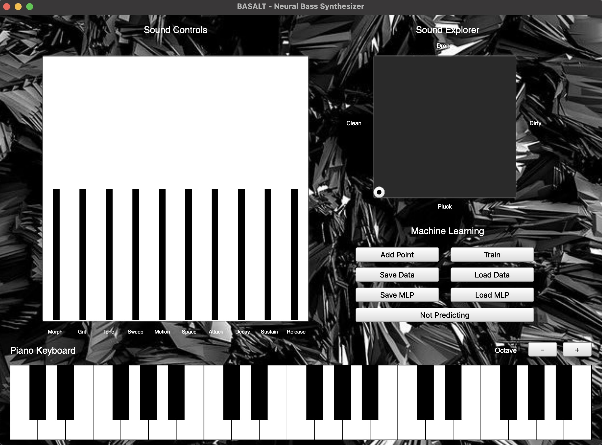

# BASALT

## Description

BASALT is a neural network-controlled bass synthesizer developed using SuperCollider and FluCoMa. It maps a two-dimensional XY controller to ten synthesis parameters, offering an intuitive way to shape, explore, and discover new bass sounds without adjusting each parameter individually.



## Requirements

Before using BASALT, make sure you have:

- SuperCollider installed: https://supercollider.github.io/
- FluCoMa (Fluid Corpus Manipulation) toolkit installed for SuperCollider: https://www.flucoma.org/
- A MIDI keyboard or MIDI input device.

## Features

### 1. Synthesis Engine

BASALT combines detuned sawtooth oscillators, pulse-width modulation, and sub-oscillators with distortion, wavefolding, resonant filtering, envelopes, and reverb to create a range of bass sounds.

### 2. Sound Controls

BASALT provides ten synthesis parameters for shaping sounds:

- **Morph:** Controls oscillator detuning, pulse width, and pulse oscillator level.
- **Grit:** Controls distortion drive and wavefolding intensity.
- **Tone:** Controls filter cutoff frequency and resonance.
- **Sweep:** Controls filter envelope attack time.
- **Motion:** Controls LFO frequency and modulation depth, affecting pulse width and filter movement.
- **Space:** Controls reverb wet/dry mix and room size.
- **Attack:** Controls amplitude envelope attack time.
- **Decay:** Controls amplitude envelope decay time.
- **Sustain:** Controls amplitude envelope sustain level.
- **Release:** Controls amplitude envelope release time.

### 3. Sound Explorer

The Sound Explorer allows users to navigate between different bass sounds, ranging from clean to dirty on the horizontal axis and pluck to drone on the vertical axis.

### 4. Machine Learning

BASALT uses FluCoMa's `FluidMLPRegressor` to learn the relationship between XY coordinates and ten synthesis parameters. Users can create their own training examples and train the neural network to explore a customized sound space.

### 5. Piano Keyboard and MIDI

BASALT includes a three-octave on-screen piano keyboard with octave controls and supports external MIDI keyboards for polyphonic performance.

## Installation

1. Install the required software listed above.
2. Download the BASALT project folder and open `BASALT.scd` in SuperCollider.
3. Keep all project files in the same folder so the background image, training data, and model files can be loaded correctly.

**Note:** BASALT runs as a standalone SuperCollider instrument, not an AU, VST, or VST3 plugin.

## How to Use

### 1. Launching BASALT

Place your cursor inside the outer parentheses of `BASALT.scd` and press `Cmd + Enter` (macOS) or `Ctrl + Enter` (Windows/Linux) to execute the code. The interface will open once the audio server boots.

### 2. Playing and Exploring Sounds

1. Play notes using the on-screen piano keyboard or an external MIDI controller.
2. Click **Load MLP** to load the included trained neural network.
3. Enable **Predicting** and move the Sound Explorer to discover different bass sounds.
4. Fine-tune the sound using the ten Sound Controls if desired.

### 3. Creating and Training Your Own Sounds

1. Disable **Predicting** and adjust the Sound Controls to create a sound.
2. Move the Sound Explorer to the desired XY position and click **Add Point**.
3. Repeat to collect additional training examples, then click **Save Data**.
4. Click **Train** and repeat as needed until the training loss stabilizes.
5. Click **Save MLP** to save the trained model, then enable **Predicting** to explore your sounds.

Training data and models are saved as JSON files:

- **xydata_basalt.json:** Training XY coordinates.
- **paramsdata_basalt.json:** Corresponding synthesis parameter values.
- **mlp_basalt.json:** Trained neural network model.

Use **Load Data** to restore training examples or **Load MLP** to restore a trained model.

### 4. Stopping BASALT

Close the interface window to exit BASALT.

To stop all running synths, press `Cmd + .` (macOS) or `Ctrl + .` (Windows/Linux).

To shut down the audio server completely, execute:

```supercollider
s.quit;
```